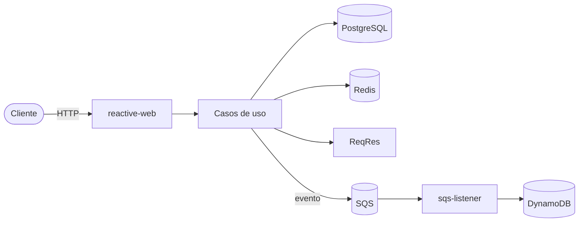

# User Administration

Servicio reactivo para administrar usuarios. Importa usuarios desde [ReqRes](https://reqres.in), los guarda en PostgreSQL, cachea las consultas en Redis y publica un evento por cada usuario creado. Un consumidor del mismo servicio procesa esos eventos y guarda una copia normalizada en mayúsculas en DynamoDB.

## Características

- Creación idempotente de usuarios a partir de ReqRes.
- Consulta por id, listado completo y búsqueda por nombre.
- Caché de consultas por id en Redis, con expiración configurable.
- Publicación de eventos en SQS y consumo con reintentos y cola de mensajes fallidos (DLQ).
- Errores en formato estándar `application/problem+json`.
- Trazas distribuidas, health checks y métricas Prometheus.

## Tecnologías

Java 17 · Spring Boot 4 · Spring WebFlux · Project Reactor · R2DBC (PostgreSQL) · Redis · AWS SDK v2 (SQS, DynamoDB) · Resilience4j · Micrometer Tracing · Testcontainers · Gradle

## Arquitectura

El proyecto sigue Clean Architecture y se generó con el [Scaffold de Bancolombia](https://bancolombia.github.io/scaffold-clean-architecture/).

```
domain/
  model/              Modelo de dominio, excepciones y puertos
  usecase/            Casos de uso
infrastructure/
  entry-points/
    reactive-web/     API HTTP
    sqs-listener/     Consumidor de eventos
  driven-adapters/
    rest-consumer/    Cliente de ReqRes
    r2dbc-postgresql/ Persistencia de usuarios
    redis/            Caché
    sqs-sender/       Publicación de eventos
    dynamo-db/        Persistencia de usuarios normalizados
  helpers/metrics/    Métricas del AWS SDK
applications/
  app-service/        Configuración y arranque
deployment/           Dockerfile, compose y scripts de infraestructura local
```



## Requisitos

- Java 17
- Podman o Docker, con compose
- AWS CLI v2 (para crear los recursos locales y revisar DynamoDB)

## Puesta en marcha

**1. Levantar la infraestructura** (PostgreSQL, Redis y MiniStack, el emulador de AWS):

```bash
podman compose -f deployment/compose.yaml up -d
```

Al crearse el contenedor de PostgreSQL se crea también la tabla `users`.

**2. Crear la cola y la tabla de AWS:**

```bash
./deployment/aws/init-resources.sh
```

**3. Ejecutar la aplicación:**

```bash
AWS_ACCESS_KEY_ID=test AWS_SECRET_ACCESS_KEY=test ./gradlew :app-service:bootRun
```

La API queda disponible en `http://localhost:8080`.

```bash
curl -s localhost:8080/actuator/health
```

### Imagen de contenedor

```bash
./gradlew :app-service:bootJar
podman build -t user-administration -f deployment/Dockerfile applications/app-service/build/libs
podman run --rm -p 8080:8080 \
  -e DB_HOST=host.containers.internal \
  -e REDIS_HOST=host.containers.internal \
  -e AWS_ENDPOINT=http://host.containers.internal:4566 \
  -e USER_EVENTS_QUEUE_URL=http://host.containers.internal:4566/000000000000/user-created-events \
  -e AWS_ACCESS_KEY_ID=test -e AWS_SECRET_ACCESS_KEY=test \
  user-administration
```

## Configuración

| Variable | Valor por defecto | Descripción |
|---|---|---|
| `DB_HOST` / `DB_PORT` | `localhost` / `5432` | Servidor PostgreSQL |
| `DB_NAME` / `DB_SCHEMA` | `user_administration` / `public` | Base de datos y esquema |
| `DB_USER` / `DB_PASSWORD` | `postgres` / `postgres` | Credenciales de PostgreSQL |
| `REDIS_HOST` / `REDIS_PORT` | `localhost` / `6379` | Servidor Redis |
| `USER_CACHE_TTL` | `10m` | Tiempo de vida de un usuario en caché |
| `AWS_ACCESS_KEY_ID` / `AWS_SECRET_ACCESS_KEY` | — | Credenciales de AWS (en local, cualquier valor) |
| `AWS_REGION` | `us-east-1` | Región de AWS |
| `AWS_ENDPOINT` | `http://localhost:4566` | Endpoint del emulador; vacío para usar AWS |
| `USER_EVENTS_QUEUE_URL` | `http://localhost:4566/000000000000/user-created-events` | Cola de eventos |
| `DYNAMODB_USERS_TABLE` | `users` | Tabla de DynamoDB |
| `REQRES_API_KEY` | — | API key de ReqRes (opcional) |

## API

| Método | Ruta | Descripción | Respuestas |
|---|---|---|---|
| `PUT` | `/api/v1/users/{id}` | Importa el usuario desde ReqRes | `201` creado · `200` ya existía · `400` · `404` · `502` |
| `GET` | `/api/v1/users/{id}` | Consulta un usuario | `200` · `400` · `404` |
| `GET` | `/api/v1/users` | Lista todos los usuarios | `200` |
| `GET` | `/api/v1/users?name={texto}` | Busca por nombre (sin distinguir mayúsculas) | `200` · `400` |

### Ejemplos

```bash
curl -i -X PUT localhost:8080/api/v1/users/7
```

```http
HTTP/1.1 201 Created
Location: http://localhost:8080/api/v1/users/7
Content-Type: application/json

{"id":7,"email":"michael.lawson@reqres.in","firstName":"Michael","lastName":"Lawson","avatar":"https://reqres.in/img/faces/7-image.jpg"}
```

```bash
curl -s localhost:8080/api/v1/users/7
curl -s localhost:8080/api/v1/users
curl -s "localhost:8080/api/v1/users?name=mich"
```

Errores:

```bash
curl -s localhost:8080/api/v1/users/99
```

```json
{"detail":"User with id 99 does not exist","instance":"/api/v1/users/99","status":404,"title":"Not Found"}
```

### Observabilidad

- `GET /actuator/health`: estado de la aplicación, PostgreSQL, Redis y el circuit breaker de ReqRes.
- `GET /actuator/prometheus`: métricas.
- Cada línea de log incluye `traceId` y `spanId`, y la traza se propaga a los servicios externos con el header `traceparent`.

## Verificación local

Para los comandos de AWS:

```bash
export AWS_ACCESS_KEY_ID=test AWS_SECRET_ACCESS_KEY=test AWS_REGION=us-east-1
alias awsl='aws --endpoint-url http://localhost:4566'
```

**Caché.** Después de consultar un usuario por id, queda guardado en Redis:

```bash
curl -s localhost:8080/api/v1/users/7 > /dev/null
podman exec deployment_redis_1 redis-cli GET user:7
podman exec deployment_redis_1 redis-cli TTL user:7
```

**Eventos.** Cada usuario creado aparece en DynamoDB con sus datos en mayúsculas:

```bash
curl -s -X PUT localhost:8080/api/v1/users/8 > /dev/null
awsl dynamodb get-item --table-name users --key '{"id":{"N":"8"}}'
```

**Mensajes fallidos.** Un mensaje que no se puede procesar se reintenta tres veces y luego pasa a la DLQ:

```bash
awsl sqs send-message --queue-url http://localhost:4566/000000000000/user-created-events --message-body 'invalid'
sleep 40
awsl sqs get-queue-attributes --queue-url http://localhost:4566/000000000000/user-created-events-dlq \
  --attribute-names ApproximateNumberOfMessages
```

## Pruebas

```bash
./gradlew clean build
```

Ejecuta las pruebas unitarias, la prueba de integración, las reglas de arquitectura (ArchUnit), la cobertura (JaCoCo) y las pruebas de mutación (Pitest).

La prueba de integración (`UserAdministrationIntegrationTest`) levanta PostgreSQL, Redis y MiniStack con Testcontainers. Si no hay Docker ni Podman disponibles, se omite. Para ejecutarla sola:

```bash
./gradlew :app-service:test --tests '*IntegrationTest'
```

Con Podman en macOS, Testcontainers usa `/var/run/docker.sock`. Si ese socket no existe:

```bash
export DOCKER_HOST=unix://$(podman machine inspect --format '{{.ConnectionInfo.PodmanSocket.Path}}')
```

Los reportes se generan en `<módulo>/build/reports/` (`tests`, `jacocoHtml` y `pitest`).

## Solución de problemas

| Síntoma | Solución |
|---|---|
| El puerto `4566` ya está en uso | Ya hay otro emulador de AWS corriendo. Úsalo y levanta solo `podman compose -f deployment/compose.yaml up -d postgres redis` |
| `Error polling sqs queue` en el log | La cola no existe o el emulador no está activo. Ejecuta `./deployment/aws/init-resources.sh` |
| `Unable to load credentials` en el log | Define `AWS_ACCESS_KEY_ID` y `AWS_SECRET_ACCESS_KEY` |
| `PUT` responde `502` | ReqRes no está disponible o rechazó la API key configurada |
| Gradle no reconoce un módulo nuevo | Borra `.gradle/configuration-cache` y vuelve a compilar |
