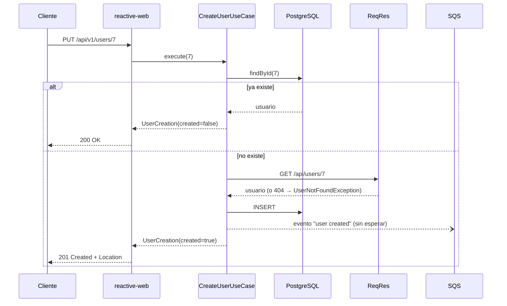
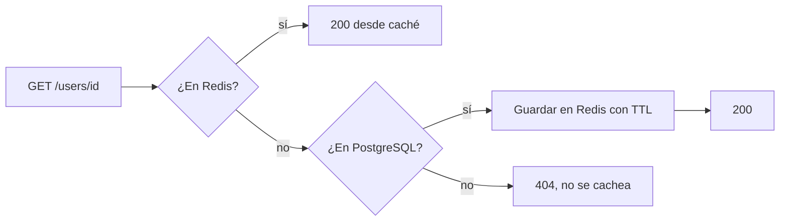
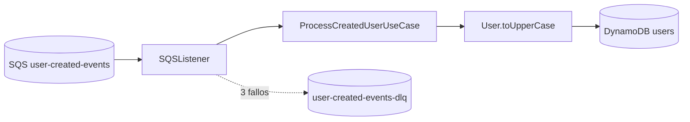

# User Administration

Microservicio reactivo que importa usuarios desde [ReqRes](https://reqres.in), los guarda en PostgreSQL, cachea las consultas en Redis y publica un evento en SQS. Un consumidor del mismo servicio recibe el evento, pasa los datos del usuario a mayúsculas y los guarda en DynamoDB.

Se construyó como reto de onboarding con **Spring Boot 4 + WebFlux**, **Clean Architecture** (Scaffold de Bancolombia) y **Project Reactor** de punta a punta: el código de producción no tiene ningún `.block()`.

## Contenido

1. [Requisitos del reto y dónde se cumplen](#1-requisitos-del-reto-y-dónde-se-cumplen)
2. [Arquitectura](#2-arquitectura)
3. [Prerrequisitos](#3-prerrequisitos)
4. [Puesta en marcha](#4-puesta-en-marcha)
5. [API](#5-api)
6. [Guía de pruebas manuales](#6-guía-de-pruebas-manuales)
7. [Pruebas automatizadas](#7-pruebas-automatizadas)
8. [Manejo de errores, logging y trazabilidad](#8-manejo-de-errores-logging-y-trazabilidad)
9. [Decisiones de diseño](#9-decisiones-de-diseño)
10. [Solución de problemas](#10-solución-de-problemas)
11. [Limitaciones conocidas](#11-limitaciones-conocidas)

---

## 1. Requisitos del reto y dónde se cumplen

| Requisito | Implementación |
|---|---|
| Crear un usuario eligiéndolo por id, con datos de ReqRes | `PUT /api/v1/users/{id}` → `CreateUserUseCase` → `RestConsumer` |
| Guardarlo en PostgreSQL de forma reactiva | R2DBC → `UserRepositoryAdapter` |
| Si ya existe, no actualizarlo y devolver el existente | `CreateUserUseCase`: primero busca en la base; responde `200` en lugar de `201` |
| Consultar por id, con mensaje si no existe | `GET /api/v1/users/{id}` → `404` con `"User with id X does not exist"` |
| Consultar todos | `GET /api/v1/users` |
| Filtrar por nombre | `GET /api/v1/users?name=...` (contiene, sin distinguir mayúsculas) |
| Caché con Redis | `FindUsersUseCase.findById` (cache-aside) → `UserCacheAdapter`, TTL configurable |
| Evento asíncrono a una cola tras crear | `UserEventPublisherPort` → `SQSSender` (fire-and-forget) |
| Entry point que lee el evento, pasa a mayúsculas y guarda en NoSQL | `SQSListener` → `ProcessCreatedUserUseCase` → `UppercaseUserRepositoryAdapter` (DynamoDB) |
| Base de datos, Redis y servicios AWS en contenedores | `deployment/compose.yaml` (PostgreSQL, Redis, MiniStack) |
| Al menos una prueba unitaria de entry point y de adaptador | `RouterRestTest`, `SQSProcessorTest`, `UserRepositoryAdapterTest`, `RestConsumerTest`, etc. |
| Al menos una prueba de integración | `UserAdministrationIntegrationTest` (Testcontainers) |
| Buenas prácticas REST | Verbos, códigos HTTP, `Location` y errores RFC 9457 (ver [API](#5-api)) |
| Trazabilidad y manejo de excepciones | Micrometer Tracing y un handler de errores central (ver [sección 8](#8-manejo-de-errores-logging-y-trazabilidad)) |

---

## 2. Arquitectura

### Módulos

```
user-administration
├── domain
│   ├── model            Entidades (User, UserCreation), excepciones y puertos (gateways)
│   └── usecase          CreateUserUseCase, FindUsersUseCase, ProcessCreatedUserUseCase
├── infrastructure
│   ├── entry-points
│   │   ├── reactive-web     API HTTP (WebFlux funcional) + ApiErrorHandler
│   │   └── sqs-listener     Consumidor de la cola de eventos
│   ├── driven-adapters
│   │   ├── rest-consumer    Cliente de ReqRes (WebClient + circuit breaker)
│   │   ├── r2dbc-postgresql Repositorio de usuarios en PostgreSQL
│   │   ├── redis            Caché de usuarios
│   │   ├── sqs-sender       Publicador de eventos
│   │   └── dynamo-db        Repositorio de usuarios en mayúsculas
│   └── helpers
│       └── metrics          Métricas del AWS SDK hacia Micrometer
├── applications
│   └── app-service      Ensambla los módulos y arranca la aplicación
└── deployment           Dockerfile, compose.yaml, esquema SQL y script de recursos AWS
```

**Regla de dependencias:** el dominio (`model`, `usecase`) no conoce Spring, ni bases de datos, ni AWS. Solo depende de Reactor y de Lombok. La infraestructura implementa los puertos del dominio. `ArchitectureTest` (ArchUnit) verifica estas reglas en cada build.

### Flujo de creación



### Flujo de consulta por id (cache-aside)



### Flujo del evento



---

## 3. Prerrequisitos

| Herramienta | Versión probada | Para qué |
|---|---|---|
| Java | 17 | Compilar y ejecutar. Gradle se usa a través del wrapper (`./gradlew`) |
| Podman (o Docker) | Podman 6 | PostgreSQL, Redis, MiniStack y la prueba de integración |
| podman-compose / docker compose | — | Levantar la infraestructura |
| AWS CLI v2 | 2.x | Crear la cola y la tabla, y revisar DynamoDB |
| curl | — | Probar la API |

> En macOS con Podman, Testcontainers usa `/var/run/docker.sock`. Si ese socket no existe, apunta `DOCKER_HOST` al de Podman:
> `export DOCKER_HOST=unix://$(podman machine inspect --format '{{.ConnectionInfo.PodmanSocket.Path}}')`

---

## 4. Puesta en marcha

### 4.1 Levantar la infraestructura

```bash
podman compose -f deployment/compose.yaml up -d
```

Levanta PostgreSQL (`5432`), Redis (`6379`) y MiniStack (`4566`). Al crearse el contenedor de PostgreSQL, se ejecuta `deployment/postgres/init.sql` y se crea la tabla `users`.

> Si ya tienes otro MiniStack o LocalStack en el puerto `4566`, levanta solo `podman compose -f deployment/compose.yaml up -d postgres redis` y usa el que ya tienes.

Comprueba que todo esté arriba:

```bash
podman compose -f deployment/compose.yaml ps
```

### 4.2 Crear los recursos de AWS (cola, DLQ y tabla)

```bash
./deployment/aws/init-resources.sh
```

Crea:
- la cola `user-created-events`, con su DLQ `user-created-events-dlq` (`maxReceiveCount: 3`);
- la tabla DynamoDB `users` (partition key `id`, numérica).

Se puede ejecutar varias veces sin errores.

### 4.3 Variables de entorno

Todas tienen un valor por defecto para trabajar en local. En la práctica solo hace falta definir las credenciales de AWS.

| Variable | Por defecto | Descripción |
|---|---|---|
| `AWS_ACCESS_KEY_ID` / `AWS_SECRET_ACCESS_KEY` | — | **Necesarias para SQS y DynamoDB.** En local, cualquier valor sirve (`test` / `test`). Sin ellas la app arranca, pero no puede publicar ni consumir eventos |
| `AWS_REGION` | `us-east-1` | Región de AWS |
| `AWS_ENDPOINT` | `http://localhost:4566` | Endpoint del emulador. **Vacío** = endpoint real de AWS |
| `USER_EVENTS_QUEUE_URL` | `http://localhost:4566/000000000000/user-created-events` | URL de la cola de eventos |
| `DYNAMODB_USERS_TABLE` | `users` | Tabla de usuarios en mayúsculas |
| `DB_HOST` / `DB_PORT` / `DB_NAME` / `DB_SCHEMA` | `localhost` / `5432` / `user_administration` / `public` | PostgreSQL |
| `DB_USER` / `DB_PASSWORD` | `postgres` / `postgres` | Credenciales de PostgreSQL |
| `REDIS_HOST` / `REDIS_PORT` | `localhost` / `6379` | Redis |
| `USER_CACHE_TTL` | `10m` | Tiempo de vida en caché (formato Spring: `30s`, `10m`, `1h`) |
| `REQRES_API_KEY` | vacío | Opcional. Si se define, se envía en el header `x-api-key` |

### 4.4 Ejecutar la aplicación

**Con Gradle:**

```bash
AWS_ACCESS_KEY_ID=test AWS_SECRET_ACCESS_KEY=test ./gradlew :app-service:bootRun
```

**Con IntelliJ:** ejecuta `MainApplication` y, en *Run configuration → Environment variables*, agrega `AWS_ACCESS_KEY_ID=test;AWS_SECRET_ACCESS_KEY=test`.

**Como contenedor:**

```bash
./gradlew :app-service:bootJar
podman build -t user-administration -f deployment/Dockerfile applications/app-service/build/libs
podman run --rm -p 8080:8080 \
  -e DB_HOST=host.containers.internal \
  -e REDIS_HOST=host.containers.internal \
  -e AWS_ENDPOINT=http://host.containers.internal:4566 \
  -e USER_EVENTS_QUEUE_URL=http://host.containers.internal:4566/000000000000/user-created-events \
  -e AWS_ACCESS_KEY_ID=test -e AWS_SECRET_ACCESS_KEY=test \
  user-administration
```

La aplicación queda en `http://localhost:8080`. Para comprobarlo:

```bash
curl -s localhost:8080/actuator/health
# {"groups":["liveness","readiness"],"status":"UP"}
```

---

## 5. API

Base: `http://localhost:8080/api/v1/users`

| Método | Ruta | Éxito | Errores |
|---|---|---|---|
| `PUT` | `/api/v1/users/{id}` | `201 Created` + `Location` (si se creó) · `200 OK` (si ya existía) | `400` id inválido · `404` no existe en ReqRes · `502` ReqRes no disponible |
| `GET` | `/api/v1/users/{id}` | `200 OK` | `400` id inválido · `404` no existe |
| `GET` | `/api/v1/users` | `200 OK` (lista, puede ser `[]`) | — |
| `GET` | `/api/v1/users?name={texto}` | `200 OK` (usuarios cuyo nombre contiene el texto) | `400` si `name` está vacío |

**¿Por qué `PUT` para crear?** El cliente elige el id del recurso y la operación es idempotente: la primera llamada crea el usuario y las siguientes devuelven el mismo, sin modificarlo. Es el uso de `PUT` que define RFC 9110 para recursos con id asignado por el cliente.

**Formato del usuario:**

```json
{
  "id": 7,
  "email": "michael.lawson@reqres.in",
  "firstName": "Michael",
  "lastName": "Lawson",
  "avatar": "https://reqres.in/img/faces/7-image.jpg"
}
```

**Formato de error** ([RFC 9457](https://www.rfc-editor.org/rfc/rfc9457), `Content-Type: application/problem+json`):

```json
{
  "title": "Not Found",
  "status": 404,
  "detail": "User with id 99 does not exist",
  "instance": "/api/v1/users/99"
}
```

**Actuator:** `GET /actuator/health` (incluye el circuit breaker `reqres`, R2DBC y Redis) y `GET /actuator/prometheus`.

---

## 6. Guía de pruebas manuales

Antes de empezar, la aplicación tiene que estar corriendo ([sección 4](#4-puesta-en-marcha)). Para las verificaciones con AWS CLI:

```bash
export AWS_ACCESS_KEY_ID=test AWS_SECRET_ACCESS_KEY=test AWS_REGION=us-east-1
alias awsl='aws --endpoint-url http://localhost:4566'
```

### 6.1 Creación de usuarios

```bash
# Usuario nuevo → 201 + Location
curl -i -X PUT localhost:8080/api/v1/users/7

# El mismo usuario otra vez → 200, sin llamar a ReqRes ni publicar otro evento
curl -i -X PUT localhost:8080/api/v1/users/7

# Usuario que no existe en ReqRes (ReqRes tiene ids del 1 al 12) → 404
curl -i -X PUT localhost:8080/api/v1/users/23

# Id inválido → 400
curl -i -X PUT localhost:8080/api/v1/users/abc
curl -i -X PUT localhost:8080/api/v1/users/0
```

Comprueba en PostgreSQL:

```bash
podman exec deployment_postgres_1 psql -U postgres -d user_administration -c 'SELECT * FROM users'
```

### 6.2 Consultas

```bash
curl -X PUT localhost:8080/api/v1/users/1 && curl -X PUT localhost:8080/api/v1/users/2

curl -i localhost:8080/api/v1/users/1          # 200
curl -i localhost:8080/api/v1/users/99         # 404 "User with id 99 does not exist"
curl -s localhost:8080/api/v1/users            # todos
curl -s "localhost:8080/api/v1/users?name=GEO" # George: no distingue mayúsculas
curl -s "localhost:8080/api/v1/users?name=zzz" # []
curl -i "localhost:8080/api/v1/users?name=%20" # 400: el nombre no puede estar vacío
```

### 6.3 Caché en Redis

```bash
podman exec deployment_redis_1 redis-cli FLUSHALL
curl -s localhost:8080/api/v1/users/1 > /dev/null    # miss: consulta PostgreSQL y guarda en Redis

podman exec deployment_redis_1 redis-cli KEYS '*'    # "user:1"
podman exec deployment_redis_1 redis-cli TTL user:1  # ~600 (10 minutos)
podman exec deployment_redis_1 redis-cli GET user:1  # JSON del usuario
```

**Prueba de que la respuesta viene de la caché:** borra la fila en PostgreSQL y vuelve a consultar.

```bash
podman exec deployment_postgres_1 psql -U postgres -d user_administration -c 'DELETE FROM users WHERE id = 1'
curl -i localhost:8080/api/v1/users/1   # sigue respondiendo 200: viene de Redis
```

**Si Redis se cae:** el servicio sigue respondiendo desde PostgreSQL.

```bash
podman stop deployment_redis_1
curl -i localhost:8080/api/v1/users/2   # 200; en el log aparece un WARN "Cache lookup failed..."
podman start deployment_redis_1
```

### 6.4 Evento y DynamoDB

```bash
curl -X PUT localhost:8080/api/v1/users/8

# A los pocos milisegundos, el usuario está en DynamoDB en mayúsculas (el avatar no cambia)
awsl dynamodb get-item --table-name users --key '{"id":{"N":"8"}}'
awsl dynamodb scan --table-name users --query 'Items[].{id:id.N,firstName:firstName.S,email:email.S}' --output table

# La cola queda vacía porque el mensaje se consumió y se borró
awsl sqs get-queue-attributes --queue-url http://localhost:4566/000000000000/user-created-events \
  --attribute-names ApproximateNumberOfMessages
```

En el log de la aplicación aparece el envío y el consumo, relacionados por el `messageId`:

```
SQSSender     : User created event sent for user 8 with message id 44a9b8ff-...
SQSProcessor  : User created event processed for user 8 from message 44a9b8ff-...
```

### 6.5 Mensaje inválido → DLQ

```bash
awsl sqs send-message --queue-url http://localhost:4566/000000000000/user-created-events --message-body 'not json'

# Se reintenta 3 veces (una cada 10 s, el visibility timeout) y luego pasa a la DLQ
sleep 40
awsl sqs get-queue-attributes --queue-url http://localhost:4566/000000000000/user-created-events-dlq \
  --attribute-names ApproximateNumberOfMessages     # 1
```

### 6.6 Trazabilidad y métricas

```bash
curl -s localhost:8080/actuator/health
curl -s localhost:8080/actuator/prometheus | grep http_server_requests_seconds_count
```

Cada línea de log de una petición lleva `[traceId-spanId]`, y el `traceId` se propaga a ReqRes en el header `traceparent` (W3C).

---

## 7. Pruebas automatizadas

```bash
./gradlew clean build
```

Compila, ejecuta todas las pruebas, valida las reglas de arquitectura (ArchUnit), mide la cobertura (JaCoCo) y hace mutation testing (Pitest).

| Tipo | Ejemplos | Qué cubren |
|---|---|---|
| Unitarias de dominio | `CreateUserUseCaseTest`, `FindUsersUseCaseTest`, `ProcessCreatedUserUseCaseTest`, `UserTest` | Flujos y errores: existe/no existe, fallo del proveedor o de la base, caché hit/miss, publicación del evento sin esperar y con el contexto de la petición, mayúsculas independientes del locale |
| Unitarias de entry points | `RouterRestTest`, `SQSProcessorTest`, `SQSListenerTest` | Códigos HTTP, `ProblemDetail`, validaciones, mensaje fallido que no se borra, reintento del polling, apagado ordenado |
| Unitarias de adaptadores | `RestConsumerTest`, `UserRepositoryAdapterTest`, `UserCacheAdapterTest`, `SQSSenderTest`, `UppercaseUserRepositoryAdapterTest` | 404 → vacío, circuit breaker, `INSERT` y clave duplicada, Redis caído, fallo de SQS, ejecución perezosa en DynamoDB |
| Integración | `UserAdministrationIntegrationTest` | La aplicación completa contra **PostgreSQL, Redis y MiniStack reales** (Testcontainers). Solo ReqRes es simulado |
| Arquitectura | `ArchitectureTest` | Reglas de Clean Architecture del Scaffold |

La prueba de integración necesita Docker o Podman. Si no hay ninguno disponible, se marca como *skipped* y el build no falla. Se excluye de Pitest para no levantar contenedores en cada mutación.

Para ejecutar solo la prueba de integración:

```bash
./gradlew :app-service:test --tests '*IntegrationTest'
```

**Reportes** (por módulo):
- Pruebas: `<módulo>/build/reports/tests/test/index.html`
- Cobertura: `applications/app-service/build/reports/jacocoHtml/index.html`
- Mutaciones: `<módulo>/build/reports/pitest/index.html`

---

## 8. Manejo de errores, logging y trazabilidad

### Errores HTTP

`ApiErrorHandler` es un filtro del router que convierte cualquier error en una respuesta `ProblemDetail`. Es el **único lugar** donde se registran en el log los errores de las peticiones.

| Excepción | HTTP | Log |
|---|---|---|
| `ServerWebInputException` (validación) | 400 | `WARN`, sin stack trace |
| `UserNotFoundException` | 404 | `WARN`, sin stack trace |
| `UserProviderException` (ReqRes caído, timeout, circuito abierto) | 502 | `ERROR`, con stack trace |
| Cualquier otra | 500, con mensaje genérico (no expone detalles internos) | `ERROR`, con stack trace |

Las excepciones técnicas se traducen a excepciones de dominio en los adaptadores (`onErrorMap`), de modo que el entry point nunca depende de clases de WebClient, R2DBC o AWS.

### Fallos que no cortan el flujo

| Componente | Si falla... | Log |
|---|---|---|
| Redis | Se trata como un *cache miss* y se responde desde PostgreSQL | `WARN` |
| SQS al publicar | La creación igual se confirma; el evento se pierde | `ERROR`, con id del usuario y stack trace |
| SQS al leer la cola | Reintento con backoff exponencial (1 s → 30 s) | `WARN` por intento |
| Procesar un mensaje | No se borra: se reentrega y, tras 3 fallos, pasa a la DLQ | `ERROR`, con `messageId` |

### Logging

- SLF4J sobre Logback, la configuración por defecto de Spring Boot.
- **Nunca** se registran datos personales (email, nombre): solo el id del usuario y el `messageId`. La API key no aparece en ningún log.

### Trazabilidad

- Micrometer Tracing (Brave). El `traceId` y el `spanId` aparecen en cada línea de log.
- `spring.reactor.context-propagation=auto` mantiene el `traceId` aunque la petición cambie de hilo.
- El `WebClient` usa el builder autoconfigurado de Spring Boot, así que propaga `traceparent` a ReqRes.
- La publicación del evento conserva el contexto de la petición: el log del `SQSSender` comparte el `traceId` del `PUT`.
- El consumo SQS es un flujo asíncrono aparte; se relaciona con el envío por el `messageId`.

---

## 9. Decisiones de diseño

- **El evento se envía sin esperar (fire-and-forget).** La respuesta no espera a SQS, y una falla de la cola no revierte una creación que ya está confirmada. El evento perdido queda registrado en `ERROR` con el id del usuario para poder republicarlo.
- **`INSERT` explícito con `R2dbcEntityTemplate`.** El id viene de ReqRes, y con un id asignado `repository.save()` haría `UPDATE`. Si dos peticiones crean el mismo usuario a la vez, la segunda recibe `DuplicateKeyException` y devuelve la fila ya guardada.
- **Un 404 de ReqRes devuelve un `Mono` vacío, no un error.** Que el usuario no exista no es una falla del proveedor, así que no cuenta como fallo para el circuit breaker. El caso de uso lo convierte en `UserNotFoundException`.
- **El circuit breaker es un operador (`CircuitBreakerOperator`), no una anotación.** Así no depende de AOP, el circuito abierto también se traduce a `UserProviderException` y se puede probar sin Spring.
- **La caché es opcional.** Un fallo de Redis nunca rompe una consulta. Los timeouts de Redis son de 500 ms para que una caída no frene las respuestas.
- **El TTL se guarda en un solo comando** (`SET ... PX`), así una clave no puede quedar sin expiración.
- **Las listas se recolectan antes de responder (`collectList`).** Así los errores de la base ocurren dentro del `Mono` y llegan al handler de errores. Para volúmenes grandes lo correcto sería paginar.
- **Las mayúsculas usan `Locale.ROOT`** para no depender del idioma del servidor (en turco, `i` pasa a `İ`). El avatar no se modifica porque es una URL y su ruta distingue mayúsculas.
- **Los adaptadores no usan helpers genéricos.** Hablan directo con Spring Data, `ReactiveRedisTemplate` o el SDK de AWS, con mapeo explícito. Los helpers del Scaffold mapeaban por reflexión con una librería que no sabe construir records.

---

## 10. Solución de problemas

| Síntoma | Causa y solución |
|---|---|
| `port 4566 already in use` al levantar compose | Ya hay otro MiniStack o LocalStack corriendo. Usa ese y levanta solo `postgres redis` |
| ReqRes responde `403 invalid_api_key` (la app devuelve `502`) | La key configurada en `REQRES_API_KEY` no es válida. Corrígela o déjala vacía |
| `Unable to load credentials from any of the providers` en el log al crear usuarios o al leer la cola | Faltan `AWS_ACCESS_KEY_ID` y `AWS_SECRET_ACCESS_KEY` (en local: `test`/`test`). La API sigue funcionando, pero los eventos no se publican |
| `Error polling sqs queue ...` en el log | La cola no existe o MiniStack no está arriba. Ejecuta `./deployment/aws/init-resources.sh`; el listener se recupera solo |
| Gradle no ve un módulo recién agregado | El caché de configuración de Gradle conserva la lista anterior. Borra `.gradle/configuration-cache` |
| La prueba de integración aparece como *skipped* | Testcontainers no encuentra Docker/Podman. En macOS, revisa `/var/run/docker.sock` ([sección 3](#3-prerrequisitos)) |

---

## 11. Limitaciones conocidas

- **Pérdida de eventos:** si SQS falla justo después de guardar, el evento se pierde (queda en el log). Para garantizar el envío habría que usar el patrón *transactional outbox*.
- **El `traceId` no viaja por la cola:** para continuar la misma traza en el consumidor habría que enviar `traceparent` como atributo del mensaje.
- **Las listas no están paginadas.**
- **El filtro por nombre solo busca en `firstName`.**
